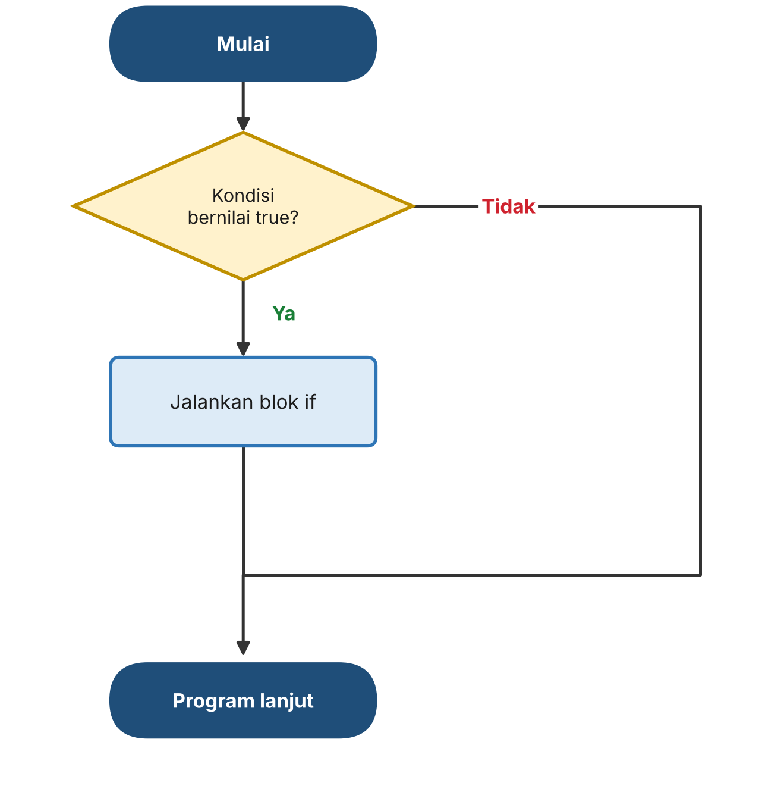
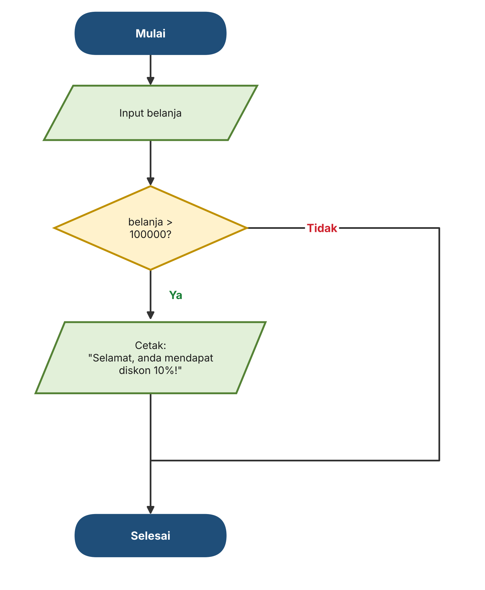
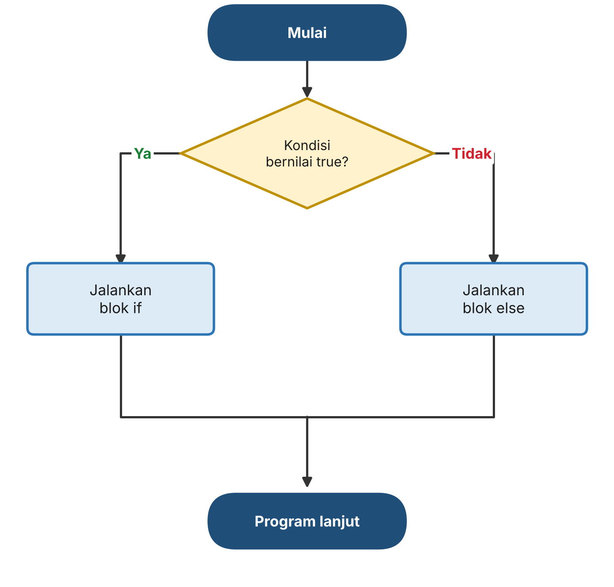
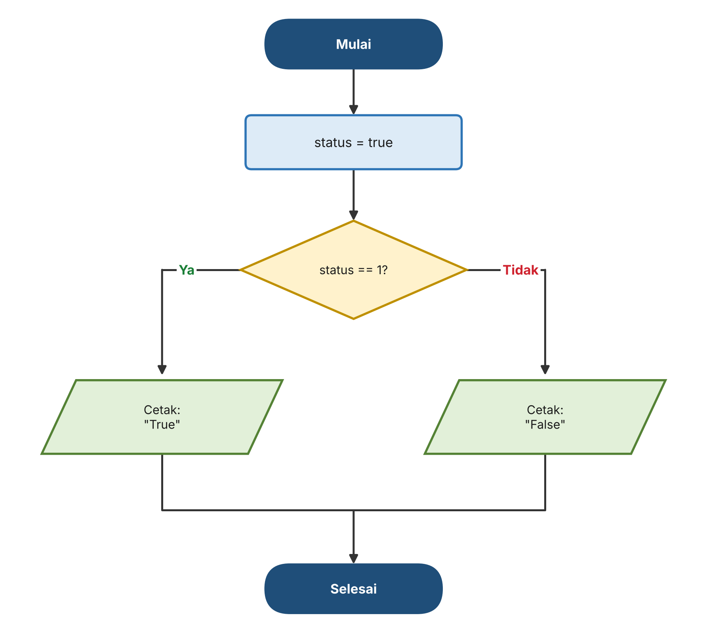
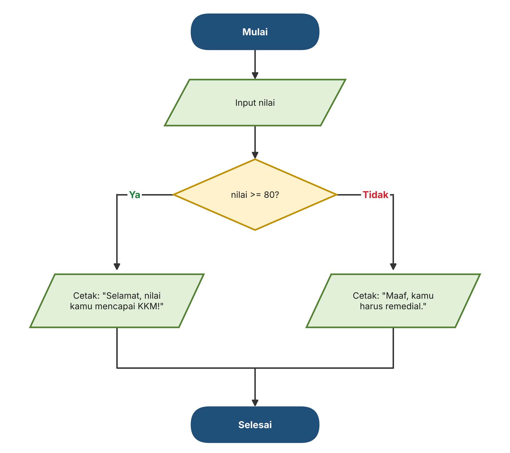
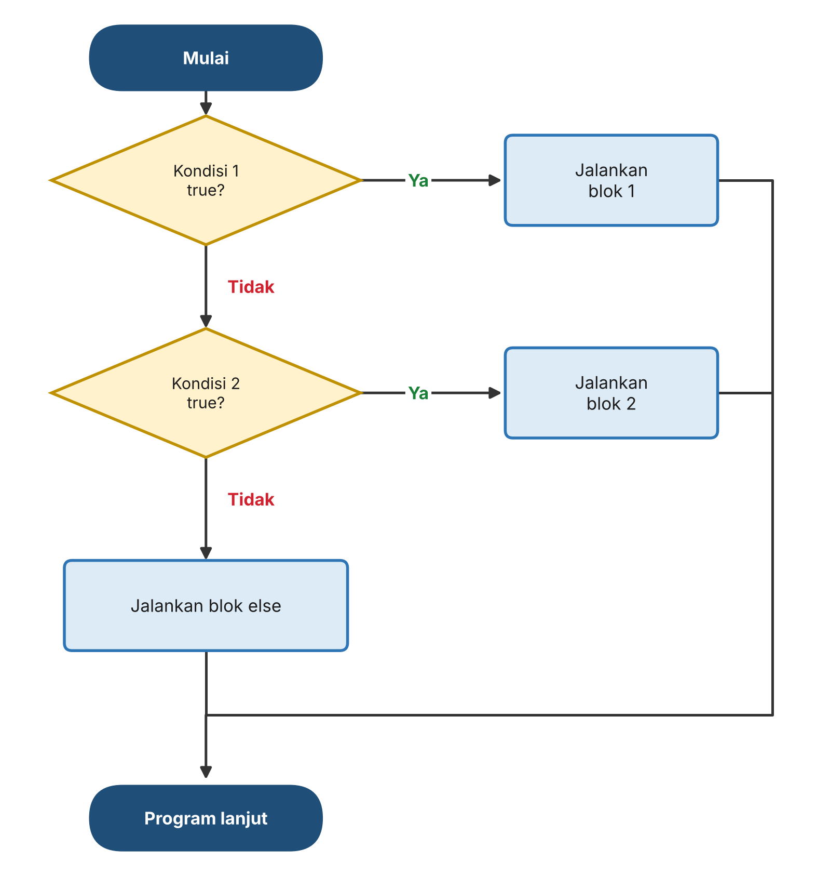
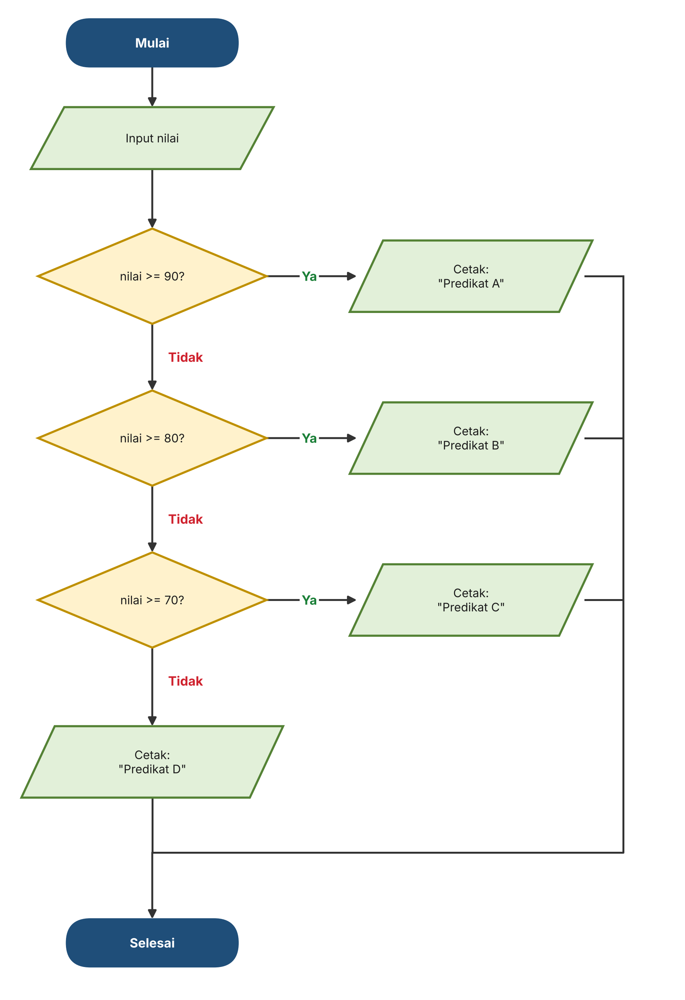
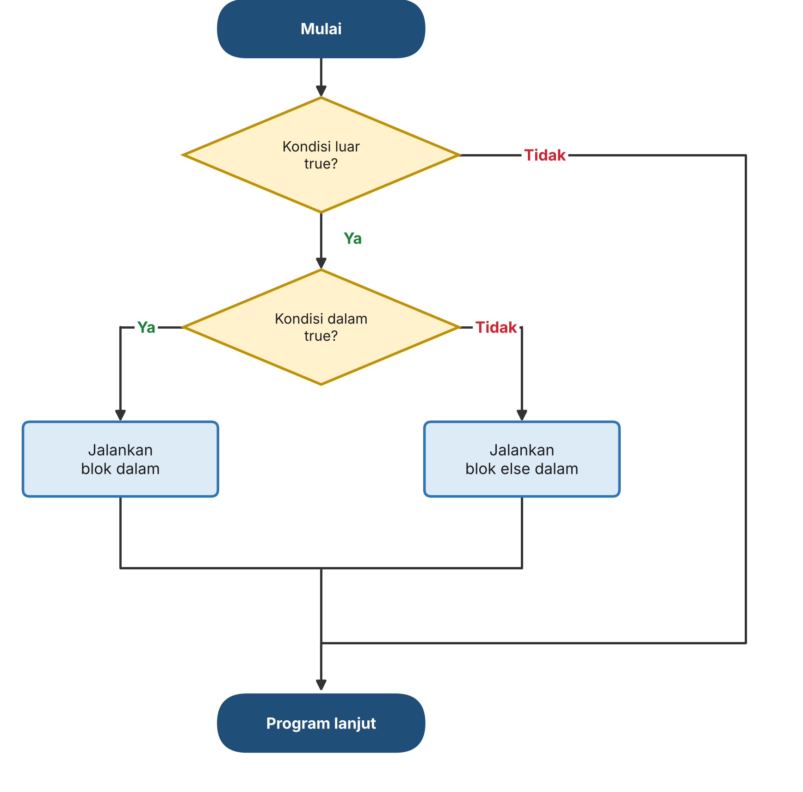
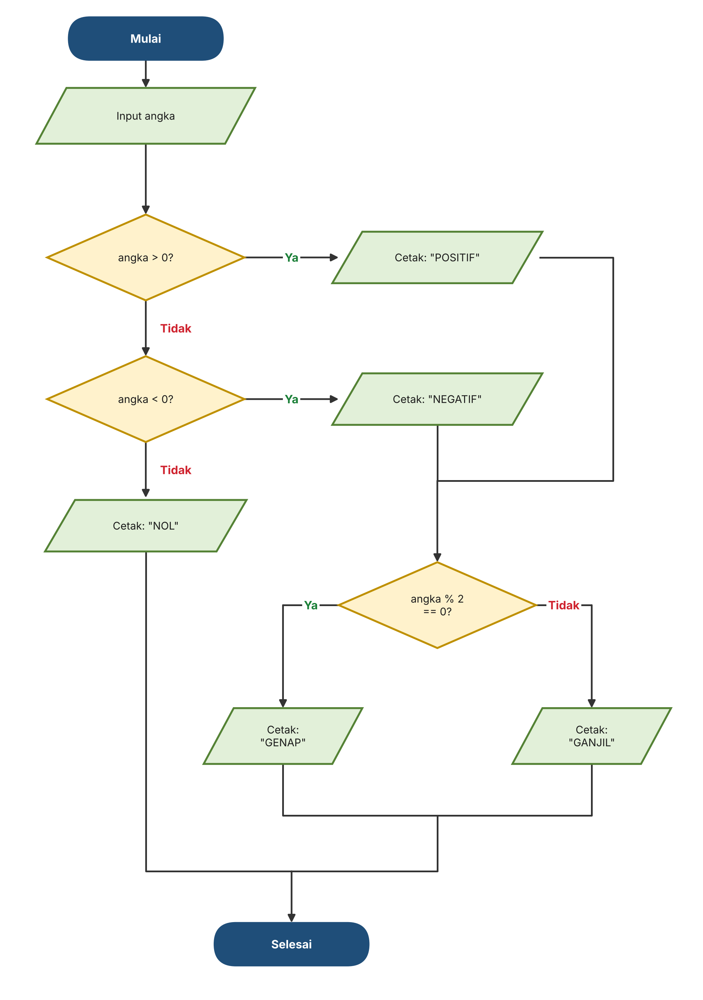
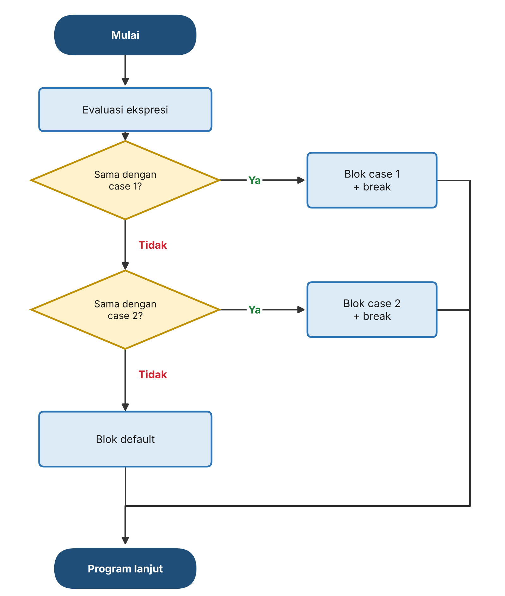

# Percabangan dalam Bahasa C

> Catatan materi Pemrograman Dasar — Kelas X RPL
> Pertemuan: Struktur Kontrol Percabangan (`if`, `if...else`, `else if`, `nested if`, `switch`)

---

## Daftar Isi

1. [Mengenal Percabangan](#1-mengenal-percabangan)
2. [Pernyataan `if`](#2-pernyataan-if)
3. [Pernyataan `if...else`](#3-pernyataan-ifelse)
4. [Pernyataan `else if`](#4-pernyataan-else-if)
5. [Nested `if`](#5-nested-if)
6. [Pernyataan `switch`](#6-pernyataan-switch)
7. [Rangkuman](#7-rangkuman)

---

## 1. Mengenal Percabangan

Secara default, program C dijalankan **berurutan dari baris paling atas ke bawah**. Namun dalam praktiknya, program sering perlu **mengambil keputusan**: melakukan sesuatu *hanya jika* suatu kondisi terpenuhi, atau memilih salah satu dari beberapa kemungkinan.

**Percabangan** (*conditional statement*) adalah struktur kontrol yang memungkinkan program memilih jalur eksekusi berdasarkan sebuah **kondisi**. Kondisi tersebut adalah ekspresi yang menghasilkan nilai **boolean** (benar atau salah) — biasanya dibentuk dari **operator perbandingan** dan **operator logika** yang sudah dipelajari sebelumnya.

Bahasa C menyediakan beberapa bentuk percabangan:

<div style="background:#f2ebff; border-left:4px solid #8250df; padding:14px 18px; border-radius:6px; margin:16px 0;">
<table style="width:100%; border-collapse:collapse; margin-top:4px;">
<thead>
<tr>
<th style="text-align:left; padding:8px 10px; border-bottom:2px solid rgba(0,0,0,0.15); font-size:0.9em;">Struktur</th>
<th style="text-align:left; padding:8px 10px; border-bottom:2px solid rgba(0,0,0,0.15); font-size:0.9em;">Fungsi</th>
</tr>
</thead>
<tbody>
<tr>
<td style="padding:8px 10px; border-bottom:1px solid rgba(0,0,0,0.1); font-size:0.9em;"><code style="background:rgba(0,0,0,0.06); padding:1px 5px; border-radius:4px;">if</code></td>
<td style="padding:8px 10px; border-bottom:1px solid rgba(0,0,0,0.1); font-size:0.9em;">Menjalankan blok kode <strong>hanya jika</strong> kondisi benar</td>
</tr>
<tr>
<td style="padding:8px 10px; border-bottom:1px solid rgba(0,0,0,0.1); font-size:0.9em;"><code style="background:rgba(0,0,0,0.06); padding:1px 5px; border-radius:4px;">if...else</code></td>
<td style="padding:8px 10px; border-bottom:1px solid rgba(0,0,0,0.1); font-size:0.9em;">Memilih <strong>satu dari dua</strong> jalur: kondisi benar atau salah</td>
</tr>
<tr>
<td style="padding:8px 10px; border-bottom:1px solid rgba(0,0,0,0.1); font-size:0.9em;"><code style="background:rgba(0,0,0,0.06); padding:1px 5px; border-radius:4px;">else if</code></td>
<td style="padding:8px 10px; border-bottom:1px solid rgba(0,0,0,0.1); font-size:0.9em;">Memilih <strong>satu dari banyak</strong> jalur dengan beberapa kondisi berurutan</td>
</tr>
<tr>
<td style="padding:8px 10px; border-bottom:1px solid rgba(0,0,0,0.1); font-size:0.9em;"><code style="background:rgba(0,0,0,0.06); padding:1px 5px; border-radius:4px;">nested if</code></td>
<td style="padding:8px 10px; border-bottom:1px solid rgba(0,0,0,0.1); font-size:0.9em;">Menaruh percabangan <strong>di dalam</strong> percabangan lain</td>
</tr>
<tr>
<td style="padding:8px 10px; font-size:0.9em;"><code style="background:rgba(0,0,0,0.06); padding:1px 5px; border-radius:4px;">switch</code></td>
<td style="padding:8px 10px; font-size:0.9em;">Memilih jalur berdasarkan <strong>nilai tertentu</strong> dari sebuah variabel</td>
</tr>
</tbody>
</table>
</div>

<div style="background:#ddf4ff; border-left:4px solid #218bff; padding:14px 18px; border-radius:6px; margin:16px 0;">
Penulisan kata kunci <code style="background:rgba(0,0,0,0.06); padding:1px 5px; border-radius:4px;">if</code>, <code style="background:rgba(0,0,0,0.06); padding:1px 5px; border-radius:4px;">else</code>, <code style="background:rgba(0,0,0,0.06); padding:1px 5px; border-radius:4px;">switch</code>, <code style="background:rgba(0,0,0,0.06); padding:1px 5px; border-radius:4px;">case</code>, dan <code style="background:rgba(0,0,0,0.06); padding:1px 5px; border-radius:4px;">default</code> di bahasa C harus menggunakan <strong>huruf kecil</strong>. Menulis <code style="background:rgba(0,0,0,0.06); padding:1px 5px; border-radius:4px;">If</code> atau <code style="background:rgba(0,0,0,0.06); padding:1px 5px; border-radius:4px;">IF</code> akan menyebabkan error.
</div>

---

## 2. Pernyataan `if`

Pernyataan `if` digunakan untuk menjalankan sebuah blok kode **hanya jika kondisinya bernilai benar (`true`)**. Jika kondisi salah (`false`), blok kode tersebut dilewati.

**Sintaks:**

```c
if (kondisi) {
    // kode yang dijalankan jika kondisi bernilai true
}
```

**Diagram alur:**



### Contoh Program

Toko memberi diskon 10% jika total belanja lebih dari Rp 100.000.

```c
#include <stdio.h>

int main() {
    int belanja;

    printf("Masukkan Total Belanjaan = Rp ");
    scanf("%d", &belanja);

    if (belanja > 100000) {
        printf("Selamat, anda mendapat diskon 10%%!\n");
    }

    return 0;
}
```

Jika pengguna memasukkan `150000` (kondisi **benar**):

```
Masukkan Total Belanjaan = Rp 150000
Selamat, anda mendapat diskon 10%!
```

Jika pengguna memasukkan `50000` (kondisi **salah**), blok `if` dilewati sehingga tidak ada pesan diskon yang tercetak:

```
Masukkan Total Belanjaan = Rp 50000
```

**Diagram alur program:**



<div style="background:#ddf4ff; border-left:4px solid #218bff; padding:14px 18px; border-radius:6px; margin:16px 0;">
Untuk mencetak tanda persen (<code style="background:rgba(0,0,0,0.06); padding:1px 5px; border-radius:4px;">%</code>) di dalam <code style="background:rgba(0,0,0,0.06); padding:1px 5px; border-radius:4px;">printf()</code>, tulis dua kali: <code style="background:rgba(0,0,0,0.06); padding:1px 5px; border-radius:4px;">%%</code>. Jika hanya satu, C akan menganggapnya sebagai awal dari format specifier (seperti <code style="background:rgba(0,0,0,0.06); padding:1px 5px; border-radius:4px;">%d</code>).
</div>

---

## 3. Pernyataan `if...else`

Pernyataan `else` ditambahkan setelah `if` untuk menentukan **kode alternatif** yang dijalankan ketika kondisi `if` bernilai salah (`false`). Dengan begitu, program selalu menjalankan **tepat satu** dari dua blok.

**Sintaks:**

```c
if (kondisi) {
    // dijalankan jika kondisi bernilai true
} else {
    // dijalankan jika kondisi bernilai false
}
```

**Diagram alur:**



### Contoh Program 1 — Menggunakan Tipe `bool`

Kondisi pada `if` pada dasarnya adalah nilai boolean. Variabel `bool` bisa langsung diperiksa, asalkan **sudah diberi nilai** terlebih dahulu.

```c
#include <stdio.h>
#include <stdbool.h>

int main() {
    bool status = true;

    if (status == 1) {
        printf("True");
    } else {
        printf("False");
    }

    return 0;
}
```

**Output:**

```
True
```

**Diagram alur program:**



### Contoh Program 2 — Pengecekan Nilai KKM

```c
#include <stdio.h>

int main() {
    int nilai;

    printf("Masukkan Nilai Akhir = ");
    scanf("%d", &nilai);

    if (nilai >= 80) {
        printf("Selamat, nilai kamu mencapai KKM!\n");
    } else {
        printf("Maaf, kamu harus remedial.\n");
    }

    return 0;
}
```

Jika pengguna memasukkan `85`:

```
Masukkan Nilai Akhir = 85
Selamat, nilai kamu mencapai KKM!
```

Jika pengguna memasukkan `70`:

```
Masukkan Nilai Akhir = 70
Maaf, kamu harus remedial.
```

**Diagram alur program:**



---

## 4. Pernyataan `else if`

Jika ada **lebih dari dua kemungkinan**, gunakan `else if` untuk menambahkan kondisi baru setelah kondisi `if` pertama. Kondisi dicek **berurutan dari atas ke bawah**: begitu ada satu kondisi yang benar, blok kodenya dijalankan dan **sisa kondisi di bawahnya dilewati**. Blok `else` di akhir (opsional) dijalankan jika tidak ada satu pun kondisi yang benar.

**Sintaks:**

```c
if (kondisi1) {
    // dijalankan jika kondisi1 true
} else if (kondisi2) {
    // dijalankan jika kondisi1 false dan kondisi2 true
} else {
    // dijalankan jika semua kondisi di atas false
}
```

**Diagram alur:**



### Contoh Program — Konversi Nilai ke Predikat

```c
#include <stdio.h>

int main() {
    int nilai;

    printf("Masukkan Nilai Akhir = ");
    scanf("%d", &nilai);

    if (nilai >= 90) {
        printf("Predikat A\n");
    } else if (nilai >= 80) {
        printf("Predikat B\n");
    } else if (nilai >= 70) {
        printf("Predikat C\n");
    } else {
        printf("Predikat D\n");
    }

    return 0;
}
```

Jika pengguna memasukkan `85`:

```
Masukkan Nilai Akhir = 85
Predikat B
```

**Diagram alur program:**



<div style="background:#ddf4ff; border-left:4px solid #218bff; padding:14px 18px; border-radius:6px; margin:16px 0;">
Nilai <code style="background:rgba(0,0,0,0.06); padding:1px 5px; border-radius:4px;">85</code> tidak memenuhi <code style="background:rgba(0,0,0,0.06); padding:1px 5px; border-radius:4px;">nilai &gt;= 90</code>, sehingga lanjut dicek ke <code style="background:rgba(0,0,0,0.06); padding:1px 5px; border-radius:4px;">nilai &gt;= 80</code> yang bernilai benar. Setelah itu program langsung keluar dari rangkaian <code style="background:rgba(0,0,0,0.06); padding:1px 5px; border-radius:4px;">if...else if</code>, tanpa mengecek <code style="background:rgba(0,0,0,0.06); padding:1px 5px; border-radius:4px;">nilai &gt;= 70</code> lagi. Karena itu, <strong>urutan kondisi sangat penting</strong>.
</div>

---

## 5. Nested `if`

**Nested `if`** adalah percabangan yang berada **di dalam** blok percabangan lain. Blok bagian dalam hanya akan dicek jika kondisi di bagian luar terpenuhi. Struktur ini berguna ketika sebuah keputusan membutuhkan **pengecekan bertahap**.

**Sintaks:**

```c
if (kondisi_luar) {
    // dijalankan jika kondisi_luar true

    if (kondisi_dalam) {
        // dijalankan jika kondisi_luar DAN kondisi_dalam true
    } else {
        // dijalankan jika kondisi_luar true tetapi kondisi_dalam false
    }
}
```

**Diagram alur:**



### Contoh Program — Penguji Bilangan

Program ini mengecek apakah sebuah bilangan **positif, negatif, atau nol**, lalu (khusus untuk bilangan positif dan negatif) mengecek lagi apakah bilangan tersebut **genap atau ganjil** menggunakan operator modulus (`%`).

```c
#include <stdio.h>

int main() {
    int angka;

    printf("=== PENGUJI BILANGAN ===\n");
    printf("Masukkan sebuah bilangan bulat: ");
    scanf("%d", &angka);

    printf("\nHasil Pengecekan:\n");

    if (angka > 0) {
        printf("- Bilangan bernilai POSITIF\n");

        // Cek genap/ganjil jika positif
        if (angka % 2 == 0) {
            printf("- Bilangan ini adalah GENAP\n");
        } else {
            printf("- Bilangan ini adalah GANJIL\n");
        }
    }
    else if (angka < 0) {
        printf("- Bilangan bernilai NEGATIF\n");

        // Cek genap/ganjil jika negatif
        if (angka % 2 == 0) {
            printf("- Bilangan ini adalah GENAP\n");
        } else {
            printf("- Bilangan ini adalah GANJIL\n");
        }
    }
    else {
        printf("- Bilangan bernilai NOL (Bukan positif maupun negatif)\n");
    }

    return 0;
}
```

Jika pengguna memasukkan `7`:

```
=== PENGUJI BILANGAN ===
Masukkan sebuah bilangan bulat: 7

Hasil Pengecekan:
- Bilangan bernilai POSITIF
- Bilangan ini adalah GANJIL
```

**Diagram alur program:**



*Pada diagram, pengecekan genap/ganjil digambar satu kali karena prosesnya sama untuk bilangan positif dan negatif. Di kode, pengecekan tersebut ditulis di dalam masing-masing blok.*

Hasil untuk beberapa masukan lainnya:

<div style="background:#dafbe1; border-left:4px solid #1a7f37; padding:14px 18px; border-radius:6px; margin:16px 0;">
<table style="width:100%; border-collapse:collapse; margin-top:4px;">
<thead>
<tr>
<th style="text-align:left; padding:8px 10px; border-bottom:2px solid rgba(0,0,0,0.15); font-size:0.9em;">Masukan</th>
<th style="text-align:left; padding:8px 10px; border-bottom:2px solid rgba(0,0,0,0.15); font-size:0.9em;">Hasil</th>
</tr>
</thead>
<tbody>
<tr>
<td style="padding:8px 10px; border-bottom:1px solid rgba(0,0,0,0.1); font-size:0.9em;"><code style="background:rgba(0,0,0,0.06); padding:1px 5px; border-radius:4px;">7</code></td>
<td style="padding:8px 10px; border-bottom:1px solid rgba(0,0,0,0.1); font-size:0.9em;">POSITIF, GANJIL</td>
</tr>
<tr>
<td style="padding:8px 10px; border-bottom:1px solid rgba(0,0,0,0.1); font-size:0.9em;"><code style="background:rgba(0,0,0,0.06); padding:1px 5px; border-radius:4px;">-4</code></td>
<td style="padding:8px 10px; border-bottom:1px solid rgba(0,0,0,0.1); font-size:0.9em;">NEGATIF, GENAP</td>
</tr>
<tr>
<td style="padding:8px 10px; font-size:0.9em;"><code style="background:rgba(0,0,0,0.06); padding:1px 5px; border-radius:4px;">0</code></td>
<td style="padding:8px 10px; font-size:0.9em;">NOL (bukan positif maupun negatif)</td>
</tr>
</tbody>
</table>
</div>

> Pada program ini, `if` luar membagi bilangan menjadi tiga kelompok (positif, negatif, nol), sedangkan `if...else` di dalam blok positif dan negatif memeriksa genap/ganjil. Bilangan nol tidak masuk ke pengecekan genap/ganjil karena sudah ditangani oleh blok `else` terakhir.

---

## 6. Pernyataan `switch`

Pernyataan `switch` digunakan untuk memilih **salah satu dari banyak blok kode** berdasarkan **nilai** dari sebuah ekspresi. Cara kerjanya:

1. Ekspresi di dalam `switch (...)` dievaluasi **satu kali**.
2. Nilainya dibandingkan dengan nilai pada setiap `case`.
3. Jika ada yang cocok, blok kode pada `case` tersebut dijalankan.
4. Kata kunci **`break`** menghentikan eksekusi dan keluar dari `switch`.
5. Blok **`default`** dijalankan jika tidak ada satu pun `case` yang cocok.

**Sintaks:**

```c
switch (ekspresi) {
    case nilai1:
        // kode jika ekspresi == nilai1
        break;
    case nilai2:
        // kode jika ekspresi == nilai2
        break;
    default:
        // kode jika tidak ada case yang cocok
}
```

**Diagram alur:**



### Aturan Penting `switch`

<div style="background:#f2ebff; border-left:4px solid #8250df; padding:14px 18px; border-radius:6px; margin:16px 0;">
<table style="width:100%; border-collapse:collapse; margin-top:4px;">
<thead>
<tr>
<th style="text-align:left; padding:8px 10px; border-bottom:2px solid rgba(0,0,0,0.15); font-size:0.9em;">Aturan</th>
<th style="text-align:left; padding:8px 10px; border-bottom:2px solid rgba(0,0,0,0.15); font-size:0.9em;">Penjelasan</th>
</tr>
</thead>
<tbody>
<tr>
<td style="padding:8px 10px; border-bottom:1px solid rgba(0,0,0,0.1); font-size:0.9em;">Tipe ekspresi</td>
<td style="padding:8px 10px; border-bottom:1px solid rgba(0,0,0,0.1); font-size:0.9em;">Berupa bilangan bulat (<code style="background:rgba(0,0,0,0.06); padding:1px 5px; border-radius:4px;">int</code>) atau karakter (<code style="background:rgba(0,0,0,0.06); padding:1px 5px; border-radius:4px;">char</code>)</td>
</tr>
<tr>
<td style="padding:8px 10px; border-bottom:1px solid rgba(0,0,0,0.1); font-size:0.9em;">Nilai <code style="background:rgba(0,0,0,0.06); padding:1px 5px; border-radius:4px;">case</code></td>
<td style="padding:8px 10px; border-bottom:1px solid rgba(0,0,0,0.1); font-size:0.9em;">Harus berupa nilai tetap (konstanta) dan tidak boleh ada yang sama</td>
</tr>
<tr>
<td style="padding:8px 10px; border-bottom:1px solid rgba(0,0,0,0.1); font-size:0.9em;"><code style="background:rgba(0,0,0,0.06); padding:1px 5px; border-radius:4px;">break</code></td>
<td style="padding:8px 10px; border-bottom:1px solid rgba(0,0,0,0.1); font-size:0.9em;">Menghentikan <code style="background:rgba(0,0,0,0.06); padding:1px 5px; border-radius:4px;">switch</code>. Tanpa <code style="background:rgba(0,0,0,0.06); padding:1px 5px; border-radius:4px;">break</code>, program akan <strong>terus menjalankan <code style="background:rgba(0,0,0,0.06); padding:1px 5px; border-radius:4px;">case</code> di bawahnya</strong> meskipun nilainya tidak cocok</td>
</tr>
<tr>
<td style="padding:8px 10px; font-size:0.9em;"><code style="background:rgba(0,0,0,0.06); padding:1px 5px; border-radius:4px;">default</code></td>
<td style="padding:8px 10px; font-size:0.9em;">Opsional, dijalankan jika tidak ada <code style="background:rgba(0,0,0,0.06); padding:1px 5px; border-radius:4px;">case</code> yang cocok. Biasanya ditulis di bagian paling akhir</td>
</tr>
</tbody>
</table>
</div>

### Contoh Program — Menu Makanan

```c
#include <stdio.h>

int main() {
    int pilihan_menu;

    printf("=== MENU MAKANAN ===\n");
    printf("1. Lobster\n");
    printf("2. Ikan Gurame\n");
    printf("3. Cah Kangkung\n");
    printf("Pilih opsi (1-3): ");
    scanf("%d", &pilihan_menu);

    switch (pilihan_menu) {
        case 1:
            printf("Kamu memilih Lobster\n");
            break;
        case 2:
            printf("Kamu memilih Ikan Gurame\n");
            break;
        case 3:
            printf("Kamu memilih Cah Kangkung\n");
            break;
        default:
            printf("Tidak ada pilihan yang tepat\n");
    }

    return 0;
}
```

Jika pengguna memasukkan `2`:

```
=== MENU MAKANAN ===
1. Lobster
2. Ikan Gurame
3. Cah Kangkung
Pilih opsi (1-3): 2
Kamu memilih Ikan Gurame
```

Jika pengguna memasukkan `5` (tidak ada `case` yang cocok, sehingga `default` dijalankan):

```
=== MENU MAKANAN ===
1. Lobster
2. Ikan Gurame
3. Cah Kangkung
Pilih opsi (1-3): 5
Tidak ada pilihan yang tepat
```

**Diagram alur program:**


### `switch` atau `else if`?

<div style="background:#dafbe1; border-left:4px solid #1a7f37; padding:14px 18px; border-radius:6px; margin:16px 0;">
<table style="width:100%; border-collapse:collapse; margin-top:4px;">
<thead>
<tr>
<th style="text-align:left; padding:8px 10px; border-bottom:2px solid rgba(0,0,0,0.15); font-size:0.9em;">Gunakan</th>
<th style="text-align:left; padding:8px 10px; border-bottom:2px solid rgba(0,0,0,0.15); font-size:0.9em;">Ketika</th>
</tr>
</thead>
<tbody>
<tr>
<td style="padding:8px 10px; border-bottom:1px solid rgba(0,0,0,0.1); font-size:0.9em;"><code style="background:rgba(0,0,0,0.06); padding:1px 5px; border-radius:4px;">switch</code></td>
<td style="padding:8px 10px; border-bottom:1px solid rgba(0,0,0,0.1); font-size:0.9em;">Membandingkan <strong>satu variabel</strong> dengan <strong>beberapa nilai tetap</strong>, misalnya pilihan menu (1, 2, 3) atau nama hari</td>
</tr>
<tr>
<td style="padding:8px 10px; font-size:0.9em;"><code style="background:rgba(0,0,0,0.06); padding:1px 5px; border-radius:4px;">else if</code></td>
<td style="padding:8px 10px; font-size:0.9em;">Kondisi berupa <strong>rentang nilai</strong> atau gabungan kondisi, misalnya <code style="background:rgba(0,0,0,0.06); padding:1px 5px; border-radius:4px;">nilai &gt;= 80</code> atau <code style="background:rgba(0,0,0,0.06); padding:1px 5px; border-radius:4px;">umur &gt;= 17 &amp;&amp; punyaKTP</code></td>
</tr>
</tbody>
</table>
</div>

---

## 7. Rangkuman

- **Percabangan** memungkinkan program memilih jalur eksekusi berdasarkan kondisi yang bernilai boolean, sehingga program tidak hanya berjalan lurus dari atas ke bawah.
- **`if`** menjalankan blok kode hanya jika kondisi benar; jika salah, blok dilewati.
- **`if...else`** memilih tepat satu dari dua jalur: blok `if` jika kondisi benar, blok `else` jika salah.
- **`else if`** dipakai untuk lebih dari dua kemungkinan. Kondisi dicek berurutan dari atas, sehingga urutan penulisan kondisi sangat berpengaruh pada hasil.
- **Nested `if`** adalah percabangan di dalam percabangan, dipakai untuk pengecekan bertahap.
- **`switch`** memilih blok kode berdasarkan nilai sebuah ekspresi. Gunakan `break` di setiap `case` agar tidak lanjut ke `case` berikutnya, dan `default` untuk menangani nilai di luar pilihan yang tersedia.
- Kata kunci `if`, `else`, `switch`, `case`, dan `default` wajib ditulis dengan **huruf kecil**.

---

*Materi ini disusun untuk kebutuhan pembelajaran Pemrograman Dasar Kelas X RPL.*
