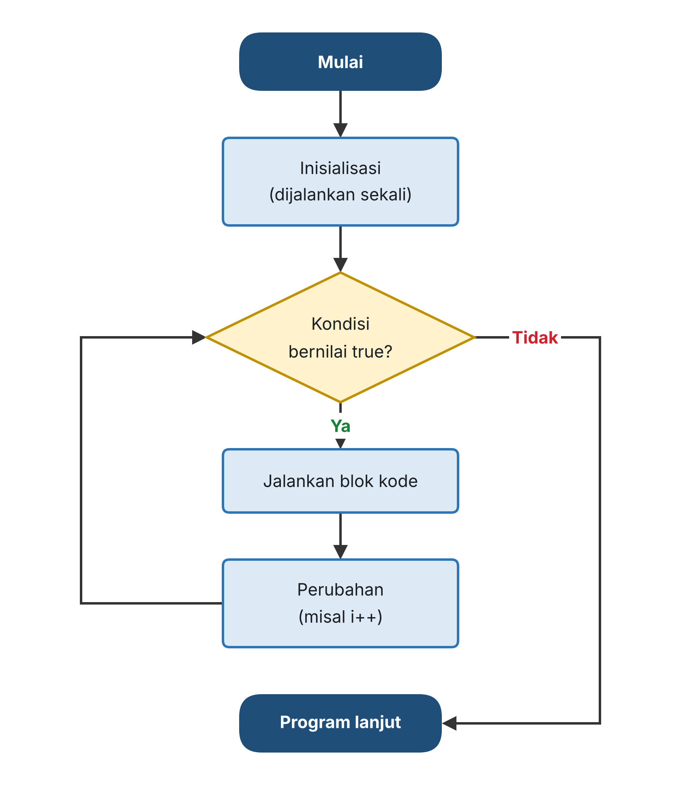
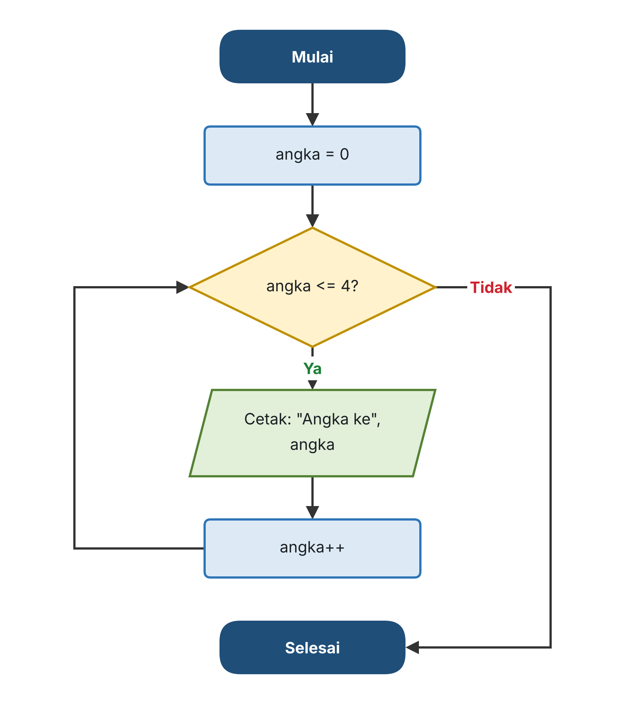
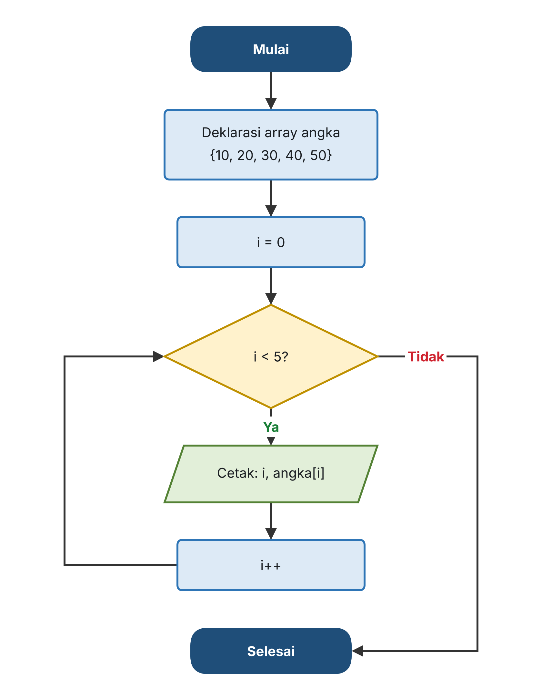

# Perulangan `for` dan Array dalam Bahasa C

> Catatan materi Pemrograman Dasar — Kelas X RPL
> Pertemuan: Struktur Kontrol Perulangan (Bagian 2) dan Array

---

## Daftar Isi

1. [Perulangan `for`](#1-perulangan-for)
2. [Nested Loop (Perulangan Bersarang)](#2-nested-loop-perulangan-bersarang)
3. [Mengenal Array](#3-mengenal-array)
4. [Mengakses dan Mengubah Elemen Array](#4-mengakses-dan-mengubah-elemen-array)
5. [Array dan Perulangan `for`](#5-array-dan-perulangan-for)
6. [Ukuran Array](#6-ukuran-array)
7. [Contoh Program Lengkap: Rata-rata Nilai Siswa](#7-contoh-program-lengkap-rata-rata-nilai-siswa)
8. [Rangkuman](#8-rangkuman)

---

## 1. Perulangan `for`

Pada materi sebelumnya kita sudah mengenal `while` dan `do...while`. Perulangan `for` dipakai ketika **jumlah pengulangan sudah diketahui**. Seluruh unsur perulangan (nilai awal, kondisi, dan perubahan nilai) ditulis **dalam satu baris**, sehingga kode lebih ringkas dan rapi.

**Sintaks:**

```c
for (inisialisasi; kondisi; perubahan) {
    // kode yang diulang selama kondisi bernilai true
}
```

**Diagram alur:**



<div markdown="1" style="background:#f2ebff; border-left:4px solid #8250df; padding:14px 18px; border-radius:6px; margin:16px 0;">

| Bagian | Fungsi | Dijalankan |
|---|---|---|
| Inisialisasi | Memberi nilai awal pada variabel penghitung, misalnya `int i = 0` | **Satu kali** di awal |
| Kondisi | Menentukan apakah perulangan lanjut, misalnya `i < 5` | Sebelum **setiap** putaran |
| Perubahan | Mengubah variabel penghitung, misalnya `i++` | Setelah **setiap** putaran |

</div>

Urutan eksekusinya: **inisialisasi**, lalu **cek kondisi**, lalu **jalankan blok kode**, lalu **perubahan**, kemudian kembali ke **cek kondisi**, dan seterusnya sampai kondisi bernilai salah.

### Contoh Program 1 — Mencetak Angka 0 sampai 4

```c
#include <stdio.h>

int main() {
    for (int angka = 0; angka <= 4; angka++) {
        printf("Angka ke %d\n", angka);
    }

    return 0;
}
```

**Output:**

```
Angka ke 0
Angka ke 1
Angka ke 2
Angka ke 3
Angka ke 4
```

**Diagram alur program:**



Program ini sama dengan perulangan `while` pada materi sebelumnya, hanya ditulis lebih ringkas:

<div markdown="1" style="background:#dafbe1; border-left:4px solid #1a7f37; padding:14px 18px; border-radius:6px; margin:16px 0;">

| Dengan `while` | Dengan `for` |
|---|---|
| `int angka = 0;` (baris tersendiri) | `int angka = 0` (di dalam tanda kurung `for`) |
| `while (angka <= 4)` | `angka <= 4` (di dalam tanda kurung `for`) |
| `angka++;` (di akhir blok) | `angka++` (di dalam tanda kurung `for`) |

</div>

### Contoh Program 2 — Perubahan dengan Kelipatan

Bagian perubahan tidak harus `i++`. Kamu bebas menggunakan `i += 2`, `i--`, dan sebagainya.

```c
#include <stdio.h>

int main() {
    for (int i = 0; i <= 4; i += 2) {
        printf("%d\n", i);
    }

    return 0;
}
```

**Output:**

```
0
2
4
```

`i += 2` berarti `i = i + 2`, sehingga nilai `i` bertambah 2 di setiap putaran (0, 2, 4). Pada nilai 6 kondisi `i <= 4` menjadi salah dan perulangan berhenti.

### Contoh Program 3 — Hitung Mundur

Gunakan `i--` dan kondisi `>=` untuk menghitung mundur.

```c
#include <stdio.h>

int main() {
    for (int i = 5; i >= 1; i--) {
        printf("%d... ", i);
    }
    printf("Selesai!\n");

    return 0;
}
```

**Output:**

```
5... 4... 3... 2... 1... Selesai!
```

### Contoh Program 4 — Menjumlahkan Angka 1 sampai 10

```c
#include <stdio.h>

int main() {
    int total = 0;

    for (int i = 1; i <= 10; i++) {
        total += i;
    }

    printf("Jumlah angka dari 1 sampai 10 adalah: %d\n", total);

    return 0;
}
```

**Output:**

```
Jumlah angka dari 1 sampai 10 adalah: 55
```

### `break` dan `continue` di dalam `for`

Pernyataan `break` dan `continue` juga bisa dipakai di dalam perulangan `for` dengan fungsi yang sama seperti pada `while`.

```c
#include <stdio.h>

int main() {
    for (int i = 1; i <= 5; i++) {
        if (i == 2) {
            continue;   // lewati putaran saat i = 2
        }
        if (i == 4) {
            break;      // hentikan perulangan saat i = 4
        }
        printf("i = %d\n", i);
    }

    return 0;
}
```

**Output:**

```
i = 1
i = 3
```

<div markdown="1" style="background:#ddf4ff; border-left:4px solid #218bff; padding:14px 18px; border-radius:6px; margin:16px 0;">

Pada perulangan `for`, `continue` **aman dipakai** karena bagian perubahan (`i++`) tetap dijalankan sebelum putaran berikutnya. Ini berbeda dengan `while`, di mana `i++` yang ada di dalam blok bisa terlewati oleh `continue`.

</div>

### Kapan Memakai `for`, `while`, atau `do...while`?

<div markdown="1" style="background:#dafbe1; border-left:4px solid #1a7f37; padding:14px 18px; border-radius:6px; margin:16px 0;">

| Gunakan | Ketika |
|---|---|
| `for` | Jumlah pengulangan **sudah diketahui**, misalnya mencetak 10 kali atau menelusuri isi array |
| `while` | Jumlah pengulangan **belum diketahui** dan bergantung pada kondisi, misalnya input sampai pengguna mengetik 0 |
| `do...while` | Blok kode **harus dijalankan minimal sekali**, misalnya menampilkan menu atau memvalidasi input |

</div>

---

## 2. Nested Loop (Perulangan Bersarang)

**Nested loop** adalah perulangan yang berada **di dalam** perulangan lain. Perulangan luar berjalan satu putaran, lalu perulangan dalam berjalan **penuh sampai selesai**. Setelah itu perulangan luar lanjut ke putaran berikutnya.

**Sintaks:**

```c
for (inisialisasi; kondisi_luar; perubahan) {
    // perulangan luar

    for (inisialisasi; kondisi_dalam; perubahan) {
        // perulangan dalam: berjalan penuh di setiap putaran luar
    }
}
```

### Contoh Program 1 — Tabel Perkalian

```c
#include <stdio.h>

int main() {
    for (int baris = 1; baris <= 3; baris++) {
        for (int kolom = 1; kolom <= 4; kolom++) {
            printf("%d x %d = %d\t", baris, kolom, baris * kolom);
        }
        printf("\n");
    }

    return 0;
}
```

**Output:**

```
1 x 1 = 1    1 x 2 = 2    1 x 3 = 3    1 x 4 = 4
2 x 1 = 2    2 x 2 = 4    2 x 3 = 6    2 x 4 = 8
3 x 1 = 3    3 x 2 = 6    3 x 3 = 9    3 x 4 = 12
```

Perulangan luar (`baris`) berjalan 3 kali. Di setiap putarannya, perulangan dalam (`kolom`) berjalan 4 kali, sehingga `printf()` di dalam dijalankan sebanyak 3 x 4 = **12 kali**. Perintah `printf("\n")` berada di perulangan luar agar pindah baris setiap satu baris selesai.

### Contoh Program 2 — Pola Segitiga Bintang

```c
#include <stdio.h>

int main() {
    for (int baris = 1; baris <= 4; baris++) {
        for (int bintang = 1; bintang <= baris; bintang++) {
            printf("* ");
        }
        printf("\n");
    }

    return 0;
}
```

**Output:**

```
*
* *
* * *
* * * *
```

<div markdown="1" style="background:#ddf4ff; border-left:4px solid #218bff; padding:14px 18px; border-radius:6px; margin:16px 0;">

Kondisi perulangan dalam `bintang <= baris` bergantung pada variabel perulangan luar. Karena itu jumlah bintang bertambah mengikuti nomor baris: baris 1 punya 1 bintang, baris 2 punya 2 bintang, dan seterusnya.

</div>

---

## 3. Mengenal Array

Bayangkan kamu perlu menyimpan nilai ujian 30 siswa. Dengan variabel biasa, kamu harus membuat 30 variabel (`nilai1`, `nilai2`, ..., `nilai30`). Cara ini tidak praktis.

**Array** adalah variabel khusus yang dapat menyimpan **banyak nilai bertipe data sama** dalam **satu nama**. Array dapat dibayangkan seperti **lemari dengan laci berurutan**: lemarinya satu (nama array), tetapi setiap laci punya nomor urut untuk menyimpan satu nilai.

**Sintaks deklarasi:**

```c
tipe_data nama_array[ukuran];
```

Contoh:

```c
int angka[5];        // array berisi 5 bilangan bulat
float harga[10];     // array berisi 10 bilangan desimal
char huruf[3];       // array berisi 3 karakter
```

### Mengisi Nilai Saat Deklarasi

Nilai awal array ditulis di dalam kurung kurawal `{ }` dan dipisahkan koma.

```c
int angka[5] = {10, 20, 30, 40, 50};
```

### Indeks Array

Setiap elemen array memiliki nomor posisi yang disebut **indeks**. Indeks array dimulai dari **0**, bukan 1.

<div markdown="1" style="background:#f2ebff; border-left:4px solid #8250df; padding:14px 18px; border-radius:6px; margin:16px 0;">

Representasi `int angka[5] = {10, 20, 30, 40, 50};`

| Indeks | `angka[0]` | `angka[1]` | `angka[2]` | `angka[3]` | `angka[4]` |
|---|---|---|---|---|---|
| Nilai | 10 | 20 | 30 | 40 | 50 |

</div>

<div markdown="1" style="background:#fff8c5; border-left:4px solid #9a6700; padding:14px 18px; border-radius:6px; margin:16px 0;">

**Perhatian**

- Array dengan ukuran 5 memiliki indeks **0 sampai 4**. Indeks terakhir selalu `ukuran - 1`.
- Mengakses indeks di luar rentang, misalnya `angka[5]` atau `angka[-1]`, **tidak menimbulkan error saat kompilasi**, tetapi hasilnya tidak terduga dan dapat membuat program bermasalah.
- Jika nilai yang ditulis kurang dari ukuran array, sisanya otomatis diisi `0`. Contoh: `int a[5] = {1, 2};` menghasilkan `1 2 0 0 0`.
- Array yang **dideklarasikan tanpa nilai awal** (misalnya `int angka[5];`) berisi nilai acak sampai kamu mengisinya.

</div>

---

## 4. Mengakses dan Mengubah Elemen Array

### Mengakses Elemen

Gunakan nama array diikuti indeks di dalam kurung siku `[ ]`.

```c
#include <stdio.h>

int main() {
    int angka[5] = {10, 20, 30, 40, 50};

    printf("Elemen indeks ke-0 adalah %d\n", angka[0]);
    printf("Elemen indeks ke-2 adalah %d\n", angka[2]);

    return 0;
}
```

**Output:**

```
Elemen indeks ke-0 adalah 10
Elemen indeks ke-2 adalah 30
```

<div markdown="1" style="background:#ddf4ff; border-left:4px solid #218bff; padding:14px 18px; border-radius:6px; margin:16px 0;">

`angka[2]` bernilai `30` karena indeks dimulai dari 0. Jadi `angka[2]` adalah elemen **ketiga** dalam array, bukan elemen kedua.

</div>

### Mengubah Elemen

Nilai elemen array diubah dengan operator penugasan (`=`), sama seperti variabel biasa.

```c
#include <stdio.h>

int main() {
    int angka[5] = {10, 20, 30, 40, 50};

    angka[1] = 25;

    printf("Elemen indeks ke-1 sekarang: %d\n", angka[1]);

    return 0;
}
```

**Output:**

```
Elemen indeks ke-1 sekarang: 25
```

---

## 5. Array dan Perulangan `for`

Menampilkan elemen array satu per satu dengan `printf()` tidak efisien. Karena indeks array berupa angka berurutan, perulangan `for` adalah pasangan yang tepat untuk menelusuri array: **variabel penghitung `i` dipakai sebagai indeks**.

```c
#include <stdio.h>

int main() {
    int angka[5] = {10, 20, 30, 40, 50};

    for (int i = 0; i < 5; i++) {
        printf("Elemen ke-%d nilainya: %d\n", i, angka[i]);
    }

    return 0;
}
```

**Output:**

```
Elemen ke-0 nilainya: 10
Elemen ke-1 nilainya: 20
Elemen ke-2 nilainya: 30
Elemen ke-3 nilainya: 40
Elemen ke-4 nilainya: 50
```

**Diagram alur program:**



<div markdown="1" style="background:#fff8c5; border-left:4px solid #9a6700; padding:14px 18px; border-radius:6px; margin:16px 0;">

**Perhatian**

Kondisi perulangan ditulis `i < 5`, bukan `i <= 5`. Jika memakai `<=`, nilai `i` mencapai `5` sehingga program mengakses `angka[5]` yang **berada di luar array**.

</div>

### Contoh Program — Dua Array Sekaligus

Array pertama diisi saat dideklarasikan. Array kedua dideklarasikan dahulu, lalu diisi **satu per satu** per indeks.

```c
#include <stdio.h>

int main() {
    int array_pertama[3] = {1, 2, 3};
    int array_kedua[3];

    array_kedua[0] = 4;
    array_kedua[1] = 5;
    array_kedua[2] = 6;

    printf("Isi array pertama:\n");
    for (int i = 0; i < 3; i++) {
        printf("array_pertama[%d] adalah: %d\n", i, array_pertama[i]);
    }

    printf("\nIsi array kedua:\n");
    for (int i = 0; i < 3; i++) {
        printf("array_kedua[%d] adalah: %d\n", i, array_kedua[i]);
    }

    return 0;
}
```

**Output:**

```
Isi array pertama:
array_pertama[0] adalah: 1
array_pertama[1] adalah: 2
array_pertama[2] adalah: 3

Isi array kedua:
array_kedua[0] adalah: 4
array_kedua[1] adalah: 5
array_kedua[2] adalah: 6
```

---

## 6. Ukuran Array

Operator `sizeof` mengembalikan **ukuran memori (dalam byte)** dari sebuah variabel atau array. Dengan membagi ukuran seluruh array dengan ukuran satu elemennya, kita bisa mendapatkan **jumlah elemen** array.

```c
#include <stdio.h>

int main() {
    int angka[5] = {10, 20, 30, 40, 50};

    printf("Ukuran seluruh array : %zu byte\n", sizeof(angka));
    printf("Ukuran satu elemen   : %zu byte\n", sizeof(angka[0]));

    int panjang = sizeof(angka) / sizeof(angka[0]);
    printf("Jumlah elemen        : %d\n", panjang);

    for (int i = 0; i < panjang; i++) {
        printf("%d ", angka[i]);
    }
    printf("\n");

    return 0;
}
```

**Output:**

```
Ukuran seluruh array : 20 byte
Ukuran satu elemen   : 4 byte
Jumlah elemen        : 5
10 20 30 40 50
```

<div markdown="1" style="background:#ddf4ff; border-left:4px solid #218bff; padding:14px 18px; border-radius:6px; margin:16px 0;">

Pada kebanyakan komputer, `int` berukuran 4 byte, sehingga array 5 elemen berukuran 5 x 4 = 20 byte. Memakai rumus `sizeof(angka) / sizeof(angka[0])` membuat perulangan tetap benar walaupun jumlah elemen array ditambah atau dikurangi, tanpa perlu mengubah angka di kondisi `for`. Format specifier untuk hasil `sizeof` adalah <code>%zu</code>.

</div>

---

## 7. Contoh Program Lengkap: Rata-rata Nilai Siswa

Program berikut meminta pengguna memasukkan 5 nilai siswa, menyimpannya dalam array, lalu menghitung total dan rata-ratanya. Program ini menggabungkan `for`, array, dan `scanf()`.

```c
#include <stdio.h>

int main() {
    int nilai[5];
    int total = 0;

    for (int i = 0; i < 5; i++) {
        printf("Masukkan nilai siswa ke-%d: ", i + 1);
        scanf("%d", &nilai[i]);
        total += nilai[i];
    }

    float rata_rata = (float) total / 5;

    printf("\nTotal nilai : %d\n", total);
    printf("Rata-rata   : %.1f\n", rata_rata);

    return 0;
}
```

Jika pengguna memasukkan `80`, `75`, `90`, `85`, dan `70`:

```
Masukkan nilai siswa ke-1: 80
Masukkan nilai siswa ke-2: 75
Masukkan nilai siswa ke-3: 90
Masukkan nilai siswa ke-4: 85
Masukkan nilai siswa ke-5: 70

Total nilai : 400
Rata-rata   : 80.0
```

<div markdown="1" style="background:#dafbe1; border-left:4px solid #1a7f37; padding:14px 18px; border-radius:6px; margin:16px 0;">

Beberapa hal yang perlu diperhatikan pada program ini:

- `scanf("%d", &nilai[i]);` menyimpan input langsung ke elemen array ke-`i`. Tanda `&` tetap dibutuhkan.
- `i + 1` dipakai saat mencetak agar pengguna melihat "siswa ke-1" dan bukan "siswa ke-0".
- `(float) total / 5` mengubah `total` menjadi `float` terlebih dahulu agar hasil pembagian memiliki angka desimal. Tanpa itu, `400 / 5` adalah pembagian bilangan bulat dan hasilnya tidak menyimpan pecahan.
- `%.1f` menampilkan bilangan desimal dengan satu angka di belakang koma.

</div>

---

## 8. Rangkuman

- **`for`** menuliskan inisialisasi, kondisi, dan perubahan dalam satu baris, dan cocok dipakai ketika jumlah pengulangan sudah diketahui.
- Urutan eksekusi `for`: inisialisasi (sekali), cek kondisi, jalankan blok, perubahan, lalu kembali ke cek kondisi.
- Bagian perubahan `for` tidak harus `i++`, bisa juga `i += 2` atau `i--` untuk hitung mundur.
- **Nested loop** adalah perulangan di dalam perulangan. Perulangan dalam berjalan penuh pada setiap satu putaran perulangan luar.
- **Array** menyimpan banyak nilai bertipe sama dalam satu nama variabel, dideklarasikan dengan `tipe_data nama[ukuran];`.
- **Indeks array dimulai dari 0**, sehingga array berukuran `n` memiliki indeks `0` sampai `n - 1`. Mengakses indeks di luar rentang berbahaya.
- Elemen array diakses dan diubah dengan `nama[indeks]`.
- Perulangan `for` dan array adalah pasangan yang ideal: variabel penghitung `i` dipakai sebagai indeks, dengan kondisi `i < ukuran`.
- Jumlah elemen array dapat dihitung dengan `sizeof(array) / sizeof(array[0])`.

---

*Materi ini disusun untuk kebutuhan pembelajaran Pemrograman Dasar Kelas X PPLG.*
