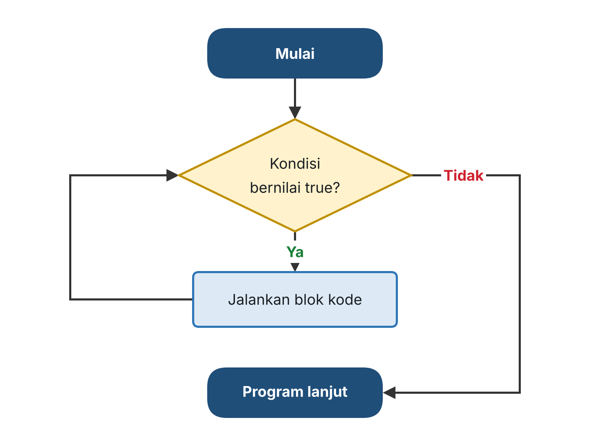
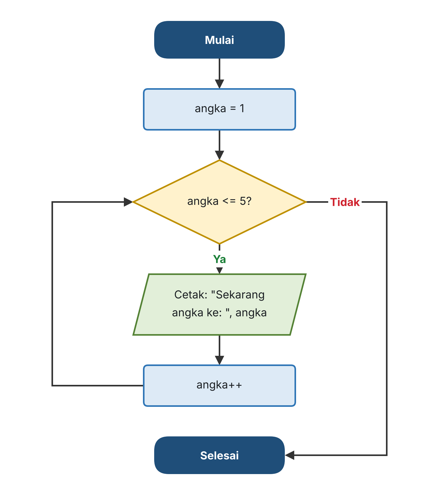
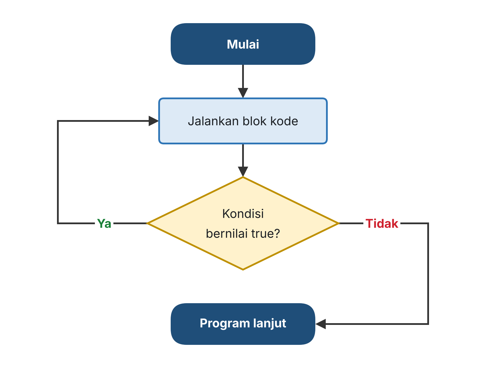
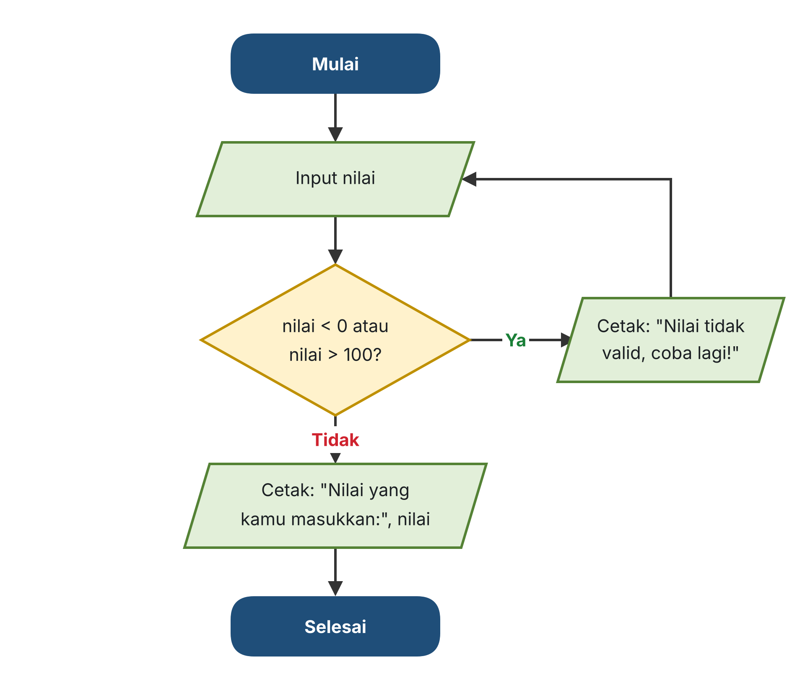
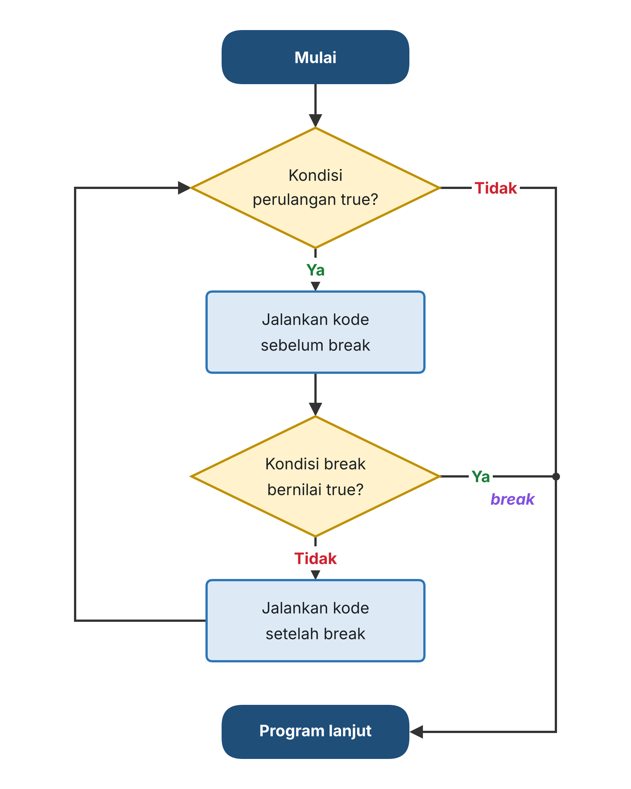
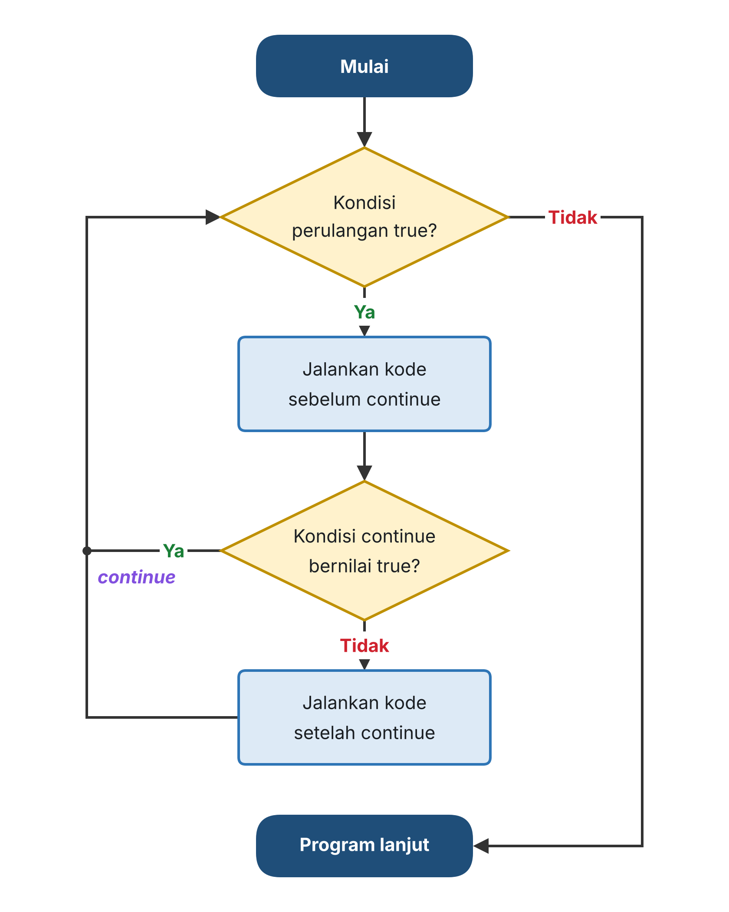
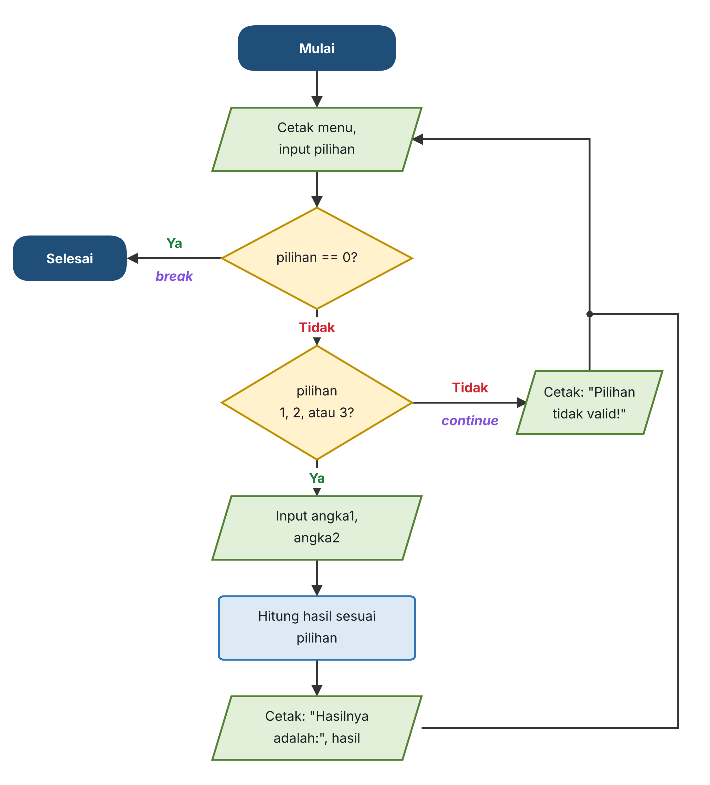

# Perulangan `while`, `do...while`, `break`, dan `continue` dalam Bahasa C

> Catatan materi Pemrograman Dasar — Kelas X RPL
> Pertemuan: Struktur Kontrol Perulangan (Bagian 1)

---

## Daftar Isi

1. [Mengenal Perulangan](#1-mengenal-perulangan)
2. [Perulangan `while`](#2-perulangan-while)
3. [Perulangan `do...while`](#3-perulangan-dowhile)
4. [Pernyataan `break`](#4-pernyataan-break)
5. [Pernyataan `continue`](#5-pernyataan-continue)
6. [Contoh Program Lengkap: Menu Kalkulator](#6-contoh-program-lengkap-menu-kalkulator)
7. [Rangkuman](#7-rangkuman)

---

## 1. Mengenal Perulangan

Bayangkan kamu diminta menampilkan tulisan `Halo` sebanyak 100 kali. Jika ditulis satu per satu dengan `printf()`, kodenya akan panjang, melelahkan, dan sulit diubah. Di sinilah **perulangan** (*loop*) dibutuhkan.

**Perulangan** adalah struktur kontrol yang menjalankan sebuah blok kode **berulang kali** selama suatu kondisi masih bernilai benar (`true`). Keuntungannya:

- Menghemat waktu dan mengurangi kesalahan penulisan kode.
- Kode lebih singkat, rapi, dan mudah dibaca.
- Jumlah pengulangan bisa mengikuti nilai variabel, bukan angka yang ditulis manual.

Bahasa C menyediakan tiga jenis perulangan:

<div markdown="1" style="background:#f2ebff; border-left:4px solid #8250df; padding:14px 18px; border-radius:6px; margin:16px 0;">

| Perulangan | Fungsi |
|---|---|
| `while` | Mengulang blok kode **selama** kondisi benar. Kondisi dicek **sebelum** blok dijalankan |
| `do...while` | Sama seperti `while`, tetapi blok kode dijalankan **minimal satu kali** karena kondisi dicek **sesudahnya** |
| `for` | Perulangan dengan jumlah pengulangan yang sudah diketahui (dibahas di materi berikutnya) |

</div>

Pada materi ini kita mempelajari `while` dan `do...while`, serta dua pernyataan pengendali perulangan, yaitu `break` dan `continue`.

Setiap perulangan yang baik memiliki **tiga unsur**:

<div markdown="1" style="background:#ddf4ff; border-left:4px solid #218bff; padding:14px 18px; border-radius:6px; margin:16px 0;">

| Unsur | Penjelasan | Contoh |
|---|---|---|
| Inisialisasi | Nilai awal variabel yang dipakai di kondisi | `int angka = 1;` |
| Kondisi | Ekspresi boolean yang menentukan apakah perulangan lanjut | `angka <= 5` |
| Perubahan nilai | Mengubah variabel agar kondisi suatu saat menjadi salah | `angka++;` |

</div>

---

## 2. Perulangan `while`

Perulangan `while` menjalankan blok kode **selama kondisinya bernilai benar (`true`)**. Kondisi dicek **lebih dulu** sebelum blok kode dijalankan. Jika kondisi sudah salah sejak awal, blok kode **tidak dijalankan sama sekali**.

**Sintaks:**

```c
while (kondisi) {
    // kode yang diulang selama kondisi bernilai true
}
```

**Diagram alur:**



### Contoh Program 1 — Mencetak Angka 1 sampai 5

```c
#include <stdio.h>

int main() {
    int angka = 1;

    while (angka <= 5) {
        printf("Sekarang angka ke: %d\n", angka);
        angka++;
    }

    return 0;
}
```

**Output:**

```
Sekarang angka ke: 1
Sekarang angka ke: 2
Sekarang angka ke: 3
Sekarang angka ke: 4
Sekarang angka ke: 5
```

**Diagram alur program:**



Cara kerja program, langkah demi langkah:

<div markdown="1" style="background:#dafbe1; border-left:4px solid #1a7f37; padding:14px 18px; border-radius:6px; margin:16px 0;">

| Putaran | Nilai `angka` | Kondisi `angka <= 5` | Aksi |
|---|---|---|---|
| 1 | 1 | true | Cetak 1, lalu `angka` menjadi 2 |
| 2 | 2 | true | Cetak 2, lalu `angka` menjadi 3 |
| 3 | 3 | true | Cetak 3, lalu `angka` menjadi 4 |
| 4 | 4 | true | Cetak 4, lalu `angka` menjadi 5 |
| 5 | 5 | true | Cetak 5, lalu `angka` menjadi 6 |
| 6 | 6 | false | Perulangan berhenti |

</div>

<div markdown="1" style="background:#fff8c5; border-left:4px solid #9a6700; padding:14px 18px; border-radius:6px; margin:16px 0;">

**Perhatian: Perulangan Tanpa Henti (*Infinite Loop*)**

Jika baris `angka++;` dihapus, nilai `angka` tidak pernah berubah dan selalu `1`. Kondisi `angka <= 5` akan **selalu benar**, sehingga program mencetak tanpa henti. Pastikan di dalam perulangan selalu ada sesuatu yang **mengubah kondisi** menjadi salah pada akhirnya. Jika program terlanjur macet, tekan <code>Ctrl + C</code> di terminal untuk menghentikannya.

</div>

### Contoh Program 2 — Input Berulang Sampai Angka 0

Perulangan `while` cocok dipakai ketika **jumlah pengulangan tidak diketahui di awal**, misalnya program terus meminta input sampai pengguna memasukkan `0`.

```c
#include <stdio.h>

int main() {
    int angka;

    printf("Masukkan angka (0 untuk keluar): ");
    scanf("%d", &angka);

    while (angka != 0) {
        printf("Kamu tadi memasukkan angka: %d\n", angka);
        printf("Masukkan angka (0 untuk keluar): ");
        scanf("%d", &angka);
    }

    printf("Kamu keluar dari program\n");

    return 0;
}
```

Jika pengguna memasukkan `5`, lalu `12`, lalu `0`:

```
Masukkan angka (0 untuk keluar): 5
Kamu tadi memasukkan angka: 5
Masukkan angka (0 untuk keluar): 12
Kamu tadi memasukkan angka: 12
Masukkan angka (0 untuk keluar): 0
Kamu keluar dari program
```

<div markdown="1" style="background:#ddf4ff; border-left:4px solid #218bff; padding:14px 18px; border-radius:6px; margin:16px 0;">

Perhatikan bahwa `scanf()` ditulis **dua kali**: sekali sebelum perulangan (agar `angka` punya nilai untuk dicek) dan sekali di akhir blok perulangan (agar nilai `angka` bisa berubah). Angka `0` yang dipakai untuk menghentikan perulangan disebut **nilai penanda** (*sentinel value*).

</div>

### Contoh Program 3 — Menjumlahkan Angka 1 sampai 10

Variabel `total` dipakai untuk **mengakumulasi** (mengumpulkan) hasil penjumlahan di setiap putaran.

```c
#include <stdio.h>

int main() {
    int i = 1;
    int total = 0;

    while (i <= 10) {
        total += i;
        i++;
    }

    printf("Jumlah angka dari 1 sampai 10 adalah: %d\n", total);

    return 0;
}
```

**Output:**

```
Jumlah angka dari 1 sampai 10 adalah: 55
```

`total += i;` adalah singkatan dari `total = total + i;`. Selama perulangan, `total` bertambah menjadi 1, 3, 6, 10, 15, 21, 28, 36, 45, lalu 55.

---

## 3. Perulangan `do...while`

Perulangan `do...while` adalah versi lain dari `while`. Bedanya, blok kode **dijalankan terlebih dahulu**, baru kemudian kondisi dicek. Artinya, blok kode **selalu dijalankan minimal satu kali**, apa pun nilai kondisinya.

**Sintaks:**

```c
do {
    // kode yang diulang
} while (kondisi);
```

**Diagram alur:**



<div markdown="1" style="background:#fff8c5; border-left:4px solid #9a6700; padding:14px 18px; border-radius:6px; margin:16px 0;">

**Perhatian**

Pada `do...while`, setelah `while (kondisi)` **wajib diakhiri tanda titik koma (`;`)**. Pada `while` biasa, tanda titik koma tidak dipakai.

</div>

### Contoh Program 1 — Mencetak Angka 1 sampai 5

```c
#include <stdio.h>

int main() {
    int angka = 1;

    do {
        printf("Angka sekarang adalah: %d\n", angka);
        angka++;
    } while (angka <= 5);

    return 0;
}
```

**Output:**

```
Angka sekarang adalah: 1
Angka sekarang adalah: 2
Angka sekarang adalah: 3
Angka sekarang adalah: 4
Angka sekarang adalah: 5
```

### Perbedaan `while` dan `do...while`

Perbedaannya terlihat jelas ketika kondisi **sudah salah sejak awal**. Pada program berikut, `angka` bernilai `10` sehingga `angka <= 5` bernilai salah.

```c
#include <stdio.h>

int main() {
    int angka = 10;

    printf("Perulangan while:\n");
    while (angka <= 5) {
        printf("angka = %d\n", angka);
        angka++;
    }

    printf("\nPerulangan do...while:\n");
    do {
        printf("angka = %d\n", angka);
        angka++;
    } while (angka <= 5);

    return 0;
}
```

**Output:**

```
Perulangan while:

Perulangan do...while:
angka = 10
```

<div markdown="1" style="background:#f2ebff; border-left:4px solid #8250df; padding:14px 18px; border-radius:6px; margin:16px 0;">

| Pembeda | `while` | `do...while` |
|---|---|---|
| Waktu pengecekan kondisi | **Sebelum** blok kode dijalankan | **Sesudah** blok kode dijalankan |
| Jumlah eksekusi minimal | 0 kali (bisa tidak dijalankan sama sekali) | 1 kali (selalu dijalankan) |
| Tanda titik koma setelah kondisi | Tidak ada | Wajib ada (`;`) |
| Cocok dipakai untuk | Perulangan yang mungkin tidak perlu dijalankan | Perulangan yang harus dijalankan dulu, misalnya meminta input |

</div>

### Contoh Program 2 — Validasi Input

`do...while` sangat cocok untuk **memvalidasi input**: program meminta input minimal sekali, lalu mengulang selama input tidak valid.

```c
#include <stdio.h>

int main() {
    int nilai;

    do {
        printf("Masukkan nilai (0-100): ");
        scanf("%d", &nilai);

        if (nilai < 0 || nilai > 100) {
            printf("Nilai tidak valid, coba lagi!\n");
        }
    } while (nilai < 0 || nilai > 100);

    printf("Nilai yang kamu masukkan: %d\n", nilai);

    return 0;
}
```

Jika pengguna memasukkan `150`, lalu `-5`, lalu `85`:

```
Masukkan nilai (0-100): 150
Nilai tidak valid, coba lagi!
Masukkan nilai (0-100): -5
Nilai tidak valid, coba lagi!
Masukkan nilai (0-100): 85
Nilai yang kamu masukkan: 85
```

**Diagram alur program:**



---

## 4. Pernyataan `break`

Pernyataan `break` digunakan untuk **menghentikan perulangan seketika**, walaupun kondisi perulangan masih bernilai benar. Setelah `break` dijalankan, program langsung **keluar dari perulangan** dan melanjutkan ke baris kode setelahnya.

(Kamu sudah pernah bertemu `break` pada materi `switch`. Fungsinya mirip: keluar dari struktur yang sedang berjalan.)

**Sintaks:**

```c
while (kondisi) {
    // ...
    if (kondisi_berhenti) {
        break;   // keluar dari perulangan
    }
    // ...
}
```

**Diagram alur:**



### Contoh Program

Perulangan seharusnya berjalan sampai `angka` bernilai 10, tetapi dihentikan lebih awal ketika `angka` mencapai 5.

```c
#include <stdio.h>

int main() {
    int angka = 1;

    while (angka <= 10) {
        if (angka == 5) {
            printf("Angka 5 ditemukan, perulangan dihentikan.\n");
            break;
        }
        printf("angka = %d\n", angka);
        angka++;
    }

    printf("Program selesai.\n");

    return 0;
}
```

**Output:**

```
angka = 1
angka = 2
angka = 3
angka = 4
Angka 5 ditemukan, perulangan dihentikan.
Program selesai.
```

<div markdown="1" style="background:#ddf4ff; border-left:4px solid #218bff; padding:14px 18px; border-radius:6px; margin:16px 0;">

**Perulangan tak terbatas yang disengaja**

Kondisi `while (true)` (atau `while (1)`) membuat perulangan berjalan terus-menerus. Teknik ini sengaja dipakai pada program menu, dan `break` menjadi satu-satunya jalan keluarnya. Untuk memakai `true` dan `false`, tambahkan <code>#include &lt;stdbool.h&gt;</code> di bagian atas program.

</div>

---

## 5. Pernyataan `continue`

Pernyataan `continue` digunakan untuk **melewati sisa kode pada putaran saat ini**, lalu langsung **lanjut ke putaran berikutnya**. Berbeda dengan `break` yang menghentikan seluruh perulangan, `continue` hanya melewati satu putaran.

<div markdown="1" style="background:#f2ebff; border-left:4px solid #8250df; padding:14px 18px; border-radius:6px; margin:16px 0;">

| Pernyataan | Yang terjadi |
|---|---|
| `break` | **Keluar** dari perulangan sepenuhnya |
| `continue` | **Melewati** sisa kode putaran ini, lalu lanjut ke putaran berikutnya |

</div>

**Sintaks:**

```c
while (kondisi) {
    // ...
    if (kondisi_lewati) {
        continue;   // lompat ke pengecekan kondisi berikutnya
    }
    // kode ini dilewati jika continue dijalankan
}
```

**Diagram alur:**



### Contoh Program

Program mencetak angka 1 sampai 6, tetapi **melewati angka 3**.

```c
#include <stdio.h>

int main() {
    int angka = 0;

    while (angka < 6) {
        angka++;
        if (angka == 3) {
            continue;
        }
        printf("angka = %d\n", angka);
    }

    return 0;
}
```

**Output:**

```
angka = 1
angka = 2
angka = 4
angka = 5
angka = 6
```

<div markdown="1" style="background:#fff8c5; border-left:4px solid #9a6700; padding:14px 18px; border-radius:6px; margin:16px 0;">

**Perhatian: Letakkan `angka++` sebelum `continue`**

Pada program di atas, `angka++` ditulis **sebelum** `if`. Jika `angka++` ditulis di akhir blok (setelah `printf`), maka ketika `angka == 3` terjadi, `continue` melompati `angka++` sehingga `angka` tetap `3` selamanya dan program **macet** dalam perulangan tanpa henti.

</div>

---

## 6. Contoh Program Lengkap: Menu Kalkulator

Program berikut menggabungkan semua yang telah dipelajari: `while (true)` untuk menampilkan menu berulang kali, `break` untuk keluar dari program, dan `continue` untuk kembali ke menu ketika pilihan tidak valid.

```c
#include <stdio.h>
#include <stdbool.h>

int main() {
    int pilihan, angka1, angka2, hasil;

    while (true) {
        printf("\n=== Pilihan Menu ===\n");
        printf("1. Penjumlahan\n");
        printf("2. Pengurangan\n");
        printf("3. Perkalian\n");
        printf("0. Keluar\n");
        printf("Pilih Opsi (0-3): ");
        scanf("%d", &pilihan);

        if (pilihan == 0) {
            break;
        }

        if (pilihan < 1 || pilihan > 3) {
            printf("Pilihan tidak valid!\n");
            continue;
        }

        printf("Masukkan Angka 1: ");
        scanf("%d", &angka1);
        printf("Masukkan Angka 2: ");
        scanf("%d", &angka2);

        if (pilihan == 1) {
            hasil = angka1 + angka2;
        } else if (pilihan == 2) {
            hasil = angka1 - angka2;
        } else {
            hasil = angka1 * angka2;
        }

        printf("Hasilnya adalah: %d\n", hasil);
    }

    printf("Terima kasih, program selesai.\n");

    return 0;
}
```

Contoh jalannya program (masukan pengguna: `1`, `8`, `5`, lalu `7`, lalu `3`, `6`, `7`, lalu `0`):

```
=== Pilihan Menu ===
1. Penjumlahan
2. Pengurangan
3. Perkalian
0. Keluar
Pilih Opsi (0-3): 1
Masukkan Angka 1: 8
Masukkan Angka 2: 5
Hasilnya adalah: 13

=== Pilihan Menu ===
1. Penjumlahan
2. Pengurangan
3. Perkalian
0. Keluar
Pilih Opsi (0-3): 7
Pilihan tidak valid!

=== Pilihan Menu ===
1. Penjumlahan
2. Pengurangan
3. Perkalian
0. Keluar
Pilih Opsi (0-3): 3
Masukkan Angka 1: 6
Masukkan Angka 2: 7
Hasilnya adalah: 42

=== Pilihan Menu ===
1. Penjumlahan
2. Pengurangan
3. Perkalian
0. Keluar
Pilih Opsi (0-3): 0
Terima kasih, program selesai.
```

**Diagram alur program:**



Alur program:

<div markdown="1" style="background:#dafbe1; border-left:4px solid #1a7f37; padding:14px 18px; border-radius:6px; margin:16px 0;">

| Pilihan pengguna | Yang terjadi |
|---|---|
| `0` | `break` dijalankan: keluar dari perulangan, lalu program selesai |
| Selain `0`, `1`, `2`, `3` | Tampil pesan "Pilihan tidak valid!", lalu `continue` mengembalikan program ke awal menu |
| `1`, `2`, atau `3` | Program meminta dua angka, menghitung hasil sesuai pilihan, lalu menampilkan menu lagi |

</div>

---

## 7. Rangkuman

- **Perulangan** menjalankan blok kode berulang kali selama kondisi bernilai benar. Perulangan yang baik memiliki inisialisasi, kondisi, dan perubahan nilai.
- **`while`** mengecek kondisi **sebelum** menjalankan blok kode, sehingga blok bisa **tidak dijalankan sama sekali**. Cocok ketika jumlah pengulangan tidak diketahui di awal.
- **`do...while`** menjalankan blok kode **dulu**, baru mengecek kondisi, sehingga blok **selalu dijalankan minimal satu kali**. Wajib diakhiri tanda titik koma (`;`) setelah kondisinya.
- Lupa mengubah variabel kondisi di dalam perulangan menyebabkan ***infinite loop***.
- **`break`** menghentikan perulangan seketika dan keluar dari perulangan.
- **`continue`** melewati sisa kode pada putaran saat ini, lalu lanjut ke putaran berikutnya.
- `while (true)` dipakai untuk membuat perulangan tak terbatas yang dihentikan dengan `break`, misalnya pada program menu. Jangan lupa `#include <stdbool.h>`.

---

*Materi ini disusun untuk kebutuhan pembelajaran Pemrograman Dasar Kelas X PPLG.*
